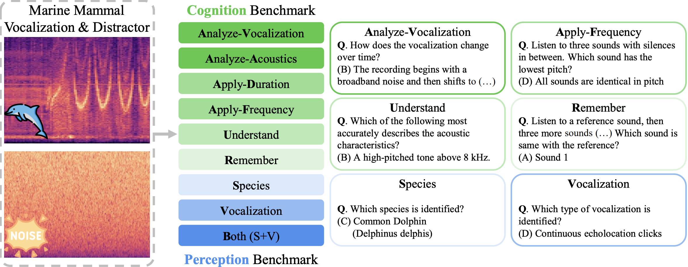

# WoW-Bench: Evaluating Fine-Grained Acoustic Perception in Audio-Language Models via Marine Mammal Vocalizations (Findings of ACL 2026)

Official repository of "WoW-Bench: Evaluating Fine-Grained Acoustic Perception in Audio-Language Models via Marine Mammal Vocalizations" (Findings of ACL 2026) 

[[Paper]](https://arxiv.org/abs/2508.20976) [[Project Page]](https://jaeyeonkim99.github.io/wow_bench/) [[Dataset]](https://huggingface.co/datasets/jaeyeonkim99/WoW-Bench)

**Abstract**
Large audio language models (LALMs) extend language understanding into the auditory domain, yet their ability to perform low-level listening, such as pitch and duration detection, remains underexplored. However, low-level listening is critical for real-world, out-of-distribution tasks where models must reason about unfamiliar sounds based on fine-grained acoustic cues. To address this gap, we introduce the World-of-Whale benchmark (WoW-Bench) to evaluate low-level auditory perception and cognition using marine mammal vocalizations. WoW-bench is composed of a Perception benchmark for categorizing novel sounds and a Cognition benchmark, inspired by Bloom's taxonomy, to assess the abilities to remember, understand, apply, and analyze sound events. For the Cognition benchmark, we additionally introduce distractor questions to evaluate whether models are truly solving problems through listening rather than relying on other heuristics. Experiments with state-of-the-art LALMs show performance far below human levels, indicating a need for stronger auditory grounding in LALMs.



## Download Dataset
- The benchmark (1,777 questions and their audio) is hosted on [Hugging Face](https://huggingface.co/datasets/jaeyeonkim99/WoW-Bench). Access requires submitting a short form, and each request is reviewed before approval. The data may be used for research and education only; commercial use requires separate permission from the [New Bedford Whaling Museum](https://www.whalingmuseum.org).
- Once your request is approved, download the benchmark into `wow_bench/`:
```bash
pip install -r requirements.txt
hf auth login
hf download jaeyeonkim99/WoW-Bench --repo-type dataset --local-dir wow_bench
```
- If you log in with a fine-grained token, enable read access to public gated repositories.
- `wow_bench/metadata.jsonl` has one line per question with `question_id`, `file_name`, `question`, `choice` and `answer`. `file_name` is the path of the audio relative to `wow_bench/`.

## Evaluation
- We provide an official evaluation script. Grading is done by an OpenAI model, so set `OPENAI_API_KEY` before running it.
```bash
export OPENAI_API_KEY=<your_key>
python evaluate.py --input <path_to_response.json> --output <path_to_output.json> --result <path_to_result.json>
```
- Inference results should be saved in a JSON file with the format `{question_id: model_response}`, where `question_id` matches the `question_id` field of `metadata.jsonl` (e.g. `cognition/analyze_acoustics/54024001_6107200R`).
- `--output` stores the extracted answer, the correctness and an explanation for every question; `--result` stores the accuracy per task, and is written as both `.json` and `.csv`.
- Other options: `--answer` (benchmark metadata, defaults to `wow_bench/metadata.jsonl`), `--model` (grading model, defaults to `gpt-4.1-mini`), `--num_workers` (defaults to 8).
- You can find example inputs and outputs in the `examples` folder. `examples/output.json` shows three of the 1,777 graded questions.


## Acknowledge
The audio recordings and associated metadata used in this work were sourced from the [Watkins Marine Mammal Sound Database, Woods Hole Oceanographic Institution, and the New Bedford Whaling Museum](https://www.whalingmuseum.org/research/digital/watkins-marine-mammal-sound-recording/). We gratefully acknowledge the [New Bedford Whaling Museum](https://www.whalingmuseum.org) for granting permission to use the database for research purposes.

## Contact
Please contact jaeyeon2@andrew.cmu.edu if you have any inquiries or problems downloading the data.

## License
The code in this repository is released under the [MIT License](LICENSE). The WoW-Bench data (questions and audio) on Hugging Face is not covered by this license and is subject to the terms on the dataset page.

## Citation
```bibtex
@inproceedings{kimwow,
  title={WoW-Bench: Evaluating Fine-Grained Acoustic Perception in Audio-Language Models via Marine Mammal Vocalizations},
  author={Kim, Jaeyeon and Yun, Heeseung and Woo, Tony and Yang, Chao-Han Huck and Kim, Gunhee},
  booktitle={Findings of ACL},
  year={2026}
}
```
